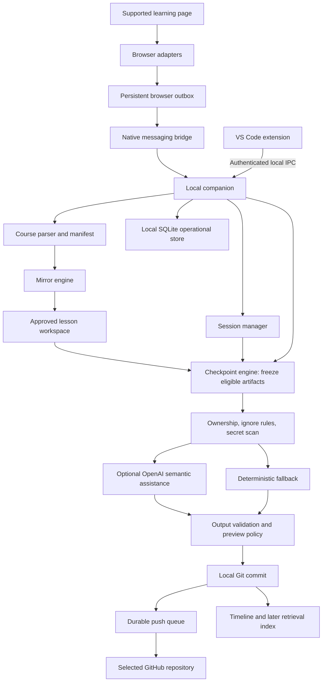

# Git for Learning: Proposed Architecture

Status: original longer-term design, prepared October 4, 2026. The Windows desktop preview is now delivered; [desktop architecture](desktop-release.md) and [current build](current-build.md) describe it. The October 10 [learning and contribution architecture](learning-architecture.md) governs the active next-release roadmap. Native messaging, a VSIX, alternative storage/runtime choices, and the monorepo below are retained design options rather than prerequisites. Desktop packaging is already shipped.

Source: `GIT_FOR_LEARNING_PRODUCT_SPEC.md`, all 112 sections, supplemented by the user's later product direction. Course Mirror and local coding shipped first. The current priority is practical learning, projects, memory, and guided open source contribution; platform breadth follows that workflow. Coding agents are explicitly deferred.

## 1. Architectural decision

Build a local-first TypeScript monorepo. A standalone companion owns persistence, approved filesystem access, checkpoint jobs, credentials, OpenAI calls, and native Git. The browser extension supplies learning context and permitted learner-code captures. The VS Code extension supplies workspace selection, session controls, lesson navigation, and optional test evidence.

The companion runs independently of VS Code. The first release joins Udemy lesson context to approved local coding workspaces, with VS Code as the preferred lesson-workspace interface. Companion-owned jobs remain recoverable after the editor closes; later browser Quick Save also works without an open editor. A hosted backend and web dashboard are later additions. Portable files and Git history are the durable learning record; the local database is an operational store and rebuildable index.

Recommended initial target: Windows with Chrome, followed by Edge verification before declaring Edge supported. macOS, Linux, Firefox, remote VS Code, WSL, and browser-only storage are separate compatibility work.



## 2. Technology choices

| Area | Proposed choice | Purpose and boundary |
| --- | --- | --- |
| Repository | TypeScript, pnpm workspaces | Shared contracts and deterministic domain modules |
| Browser | Manifest V3, React, Vite | Popup/options/full-page history UI and separately bundled worker/content scripts |
| Local runtime | Packaged, pinned Node LTS runtime | Companion and native messaging shim; desktop users should not need to install Node |
| Editor | VS Code Extension API, TypeScript | Thin client; no duplicate database or Git authority |
| Validation | Zod and versioned JSON schemas | Validate every cross-process message, portable manifest, and AI output |
| Local store | SQLite behind a storage interface | Sessions, event inbox, job journal, mappings, preferences, and later full-text search |
| SQLite driver | Proposed `better-sqlite3` in companion only | Pin and verify packaged native binary on Windows during foundation work; isolate synchronous DB work from IPC responsiveness |
| Files and Git | Native filesystem APIs and native Git with argument arrays | Watch approved roots, preserve exact snapshots, use the user's Git identity |
| GitHub | Existing Git credential helper/SSH; optional authenticated GitHub CLI | Clone/push and personal-prototype private repository creation |
| AI | Official OpenAI JavaScript SDK, Responses API, Structured Outputs | Grounded text/code tasks; no filesystem or Git tool authority |
| Verification | Vitest, temporary real Git repositories, Playwright fixtures, extension/installer smoke checks | Domain invariants, actual Git behavior, adapters, restart and packaging |
| Later hosted product | Next.js dashboard, authenticated Node API, PostgreSQL | GitHub App token broker and optional account/index services, added when needed |

Exact dependency versions and API model IDs will be pinned during implementation. The model is configuration, not embedded product behavior: select an economical Structured Outputs model for commits/notes using a small evaluation set; choose a stronger model for requested history comparisons only if justified. No paid model call is needed to approve this architecture.

## 3. Runtime and trust boundaries

### Browser extension

Content scripts run only on user-enabled supported sites. They extract titles, stable identifiers, visible completion evidence, accessible curriculum structure, and the learner's solution. Page observations are untrusted input. The isolated extension UI and worker validate them; page scripts never receive keys or local filesystem privileges.

A transactional IndexedDB outbox records capture events before transport. An event has a stable ID, adapter version, sanitized source URL, provenance, and the exact submitted artifact when available. Strip URL credentials/fragments and retain only explicitly allowlisted query fields before persistence, metadata generation, AI, or logs. Retries reuse the same ID. The browser drops its pending copy only after a durable companion acknowledgment. Apply size limits and backpressure, show pending status, and offer manual export when disconnected.

Manifest V3 workers may be terminated and lose globals. Timers and in-memory state cannot be the only record of sessions or captures. Reconnect and replay the persisted outbox on restart. See [Chrome worker lifecycle](https://developer.chrome.com/docs/extensions/develop/concepts/service-workers/lifecycle) and [extension storage](https://developer.chrome.com/docs/extensions/develop/concepts/storage-and-cookies).

An Accepted result must be correlated with the code submitted for that attempt. Reading the current editor later can capture unrelated edits. If the adapter cannot prove the association, offer manual capture and label completion evidence accurately; do not falsely record an accepted solution.

### Native messaging and companion

A small native messaging host forwards validated requests to one per-user companion. On Windows, the companion and VS Code communicate through a named pipe with a current-user ACL and an installation/pairing capability. A startup lock prevents duplicate companion owners. The companion starts in the background when needed; optional login startup requires an explicit setting. Restart recovery comes from durable jobs, not process lifetime.

The browser host is restricted to exact development/production extension IDs. Native host registration, installer/uninstaller, protocol framing, size limits, and reconnect behavior are deliverables. Chunk large inbound captures and paginate responses rather than assuming unlimited message sizes. Chrome requires a separate native host manifest and Windows registry registration; a VSIX alone is insufficient. See [Chrome native messaging](https://developer.chrome.com/docs/extensions/develop/concepts/native-messaging) and [Edge registration](https://learn.microsoft.com/en-us/microsoft-edge/extensions/developer-guide/native-messaging).

Messages use a versioned envelope: protocol version, request/event ID, device ID, command type, and validated payload. Commands are narrow operations such as `captureAttempt`, `startSession`, `finishSession`, `proposeMirror`, `applyMirrorPlan`, `addNote`, `createCheckpoint`, and `getStatus`. The bridge never accepts arbitrary shell commands, arbitrary file reads, or an instruction to upload an arbitrary directory.

Workspace registration happens through trusted companion setup or VS Code UI. A stored grant maps an opaque workspace ID to a canonical root, exclusions, allowed destination, and upload policy. Browser requests use that ID. Reject traversal, out-of-root symlinks/junctions, unsupported network paths, Windows reserved names, and case-insensitive path collisions. Revalidate grants when roots change.

### VS Code extension

Provide workspace registration, trust checks, Open Lesson Workspace, Start/Pause/Finish Session, Add Note, checkpoint preview, and pending-sync status. Require VS Code workspace trust for active integrations. Remote extension hosts are unsupported initially and must produce a clear capability message.

Observe only approved workspaces. Saved disk bytes are the default checkpoint input; show unsaved-buffer status and provide an explicit Save All action. Receive test evidence from supported integrations or an explicit learner action; do not run project scripts automatically merely because the page claims an exercise passed.

### Credential ownership

The companion owns its secret provider. Use Windows Credential Manager/OS-protected storage for packaged use. VS Code SecretStorage is appropriate for secrets owned by the editor extension, but the companion must not assume it can read that storage while VS Code is closed. See [VS Code storage capabilities](https://code.visualstudio.com/api/extension-capabilities/common-capabilities#data-storage).

For development, load the root `.env` only into the trusted companion process. The current variable is `OPEN_AI_API`; support it as an alias for conventional `OPENAI_API_KEY`, without changing or printing its value. If both are set, prefer `OPENAI_API_KEY` and report only the configuration precedence. Create ignore rules before initializing/staging the implementation repository. Exclude environment files from learning capture independently of Git ignore rules.

Never bundle `.env` into browser assets, extension packages, installers, prompts, metadata, or logs. Git credentials remain in the user's configured helper/SSH agent. Do not place tokens in repository URLs or command-line arguments. [OpenAI production guidance](https://developers.openai.com/api/docs/guides/production-best-practices) supports environment variables or secret management for API keys.

## 4. Domain model and persistence

| Entity | Essential data |
| --- | --- |
| Device | Random ID and editable label; no hardware fingerprint |
| Integration | Platform/account reference and capabilities; secrets stored separately |
| RepositoryTarget | Local clone ID, canonical remote, branch, storage mode, verified visibility |
| WorkspaceGrant | Root, selected artifact rules, exclusions, source-repo mode, upload permission |
| Course/Section/Lesson | Internal ID, platform IDs/aliases, title, order, type, discovery completeness |
| Problem | Platform identity and optional explicit cross-platform relation |
| LearningSession | Resource/lesson or topic, workspace, states, notes, start/end and observed activity |
| Event | Idempotent event ID, session/attempt, evidence, adapter version, received time |
| Attempt | Problem, language, submitted content hash, verdict/evidence, prior-attempt link |
| Artifact | Relative path, ownership/provenance, content hash, language, capture reference |
| Note | Original learner text plus separately labeled optional AI revision |
| Checkpoint | Immutable candidate hashes, reason, approved policy, state and errors |
| Commit/SyncJob | Checkpoint ID, repository, Git SHA, target branch, retry state |
| Concept/IndexChunk | Later derived tags/chunks with artifact revision and citation locations |

Session states: `active`, `idle`, `paused`, `completed`. Switching tabs does not end a session. Bind a single active lesson to a workspace at a time; other sessions may remain paused/idle. Ambiguous multi-tab attribution requires explicit selection. Activity duration is observed active time, not a claim about attention or mastery.

Checkpoint states: `captured`, `needs_review`, `blocked_secret`, `ready`, `committing`, `committed`, `push_pending`, `synced`, `sync_conflict`, `failed_retryable`, `discarded`. Local-save, commit, and remote-sync status are separate fields; a push failure never turns a completed local save into failure.

Store the database, job journal, transient captures, and process locks in `%LOCALAPPDATA%/GitForLearning`, outside OneDrive and learning repositories. Apply current-user permissions. Use one database writer, bounded transactions, migration versioning, and supported backup snapshots. A live SQLite database is not a cross-device synchronization artifact; [SQLite WAL](https://sqlite.org/wal.html) requires same-host coordination.

Portable learner data lives in Markdown, code, notebooks, and versioned JSON. The learning repository contains course manifests, selected artifacts, notes, and immutable checkpoint records. Keep machine-specific absolute paths, workspace grants, credentials, pairing capabilities, and retry state outside portable records. Put a checkpoint ID in its commit trailer; keep the resulting SHA in SQLite to avoid a self-referential commit hash inside committed metadata. Derived indexes are rebuildable; transient drafts need a separate local backup/export policy.

## 5. Platform adapter contract

Adapters report capabilities: problem context, course context, curriculum discovery, exact solution capture, completion evidence, and resource references. Common results include availability, provenance, and confidence. A missing field is unknown, not false or fabricated.

Keep URL rules, selectors, and any tightly scoped page/editor bridge inside each adapter. Prefer accessible structured data and supported official interfaces where available; do not assume paid/authenticated platforms expose a public API. No credential harvesting, session-cookie forwarding, background crawling, or downloading of gated course content.

Store sanitized fixtures and add adapter-specific health checks. Manual title/lesson selection, paste/upload of learner code, and manual checkpoint remain available when extraction breaks. Never guess successful completion from a route change alone.

Start with Udemy course/section/lesson detection and accessible curriculum discovery, plus explicit local workspace/session association. Keep partial observations honest and support manual lesson entry. Add a verified LeetCode editor/submission flow after the first Udemy release. NeetCode curriculum context may link to a LeetCode attempt; platform-specific identity and result evidence must remain separate. Add native NeetCode editor capture only after validating it independently.

## 6. Course Manifest and Mirror Engine

The parser turns adapter observations into a versioned manifest with internal IDs, external IDs/URL aliases, display ordering, progress evidence, permitted resource references, discovery scope, and completeness. Missing items in a partial observation are not evidence of removal.

The Mirror Engine takes this manifest and local mapping state. It returns a deterministic proposed change set before writing anything: create folders/placeholders, update safe managed metadata, attach references, or report conflicts. It has no platform DOM dependency.

Identity and path rules:

1. Allocate immutable internal IDs; resolve platform-scoped stable IDs first.
2. Store the allocated path separately from display title/order. A rename changes metadata without automatically moving the folder.
3. Use readable slugs and deterministic short ID suffixes to resolve collisions; validate Windows lengths and reserved names.
4. Match ambiguous identities conservatively using aliases and evidence; require review before merging or relocating learner folders.
5. New sections/lessons may be added. Removed remote items become archived metadata only when supported by sufficiently complete evidence; learner files remain.

Track remote presence, local presence/change, progress, and conflicts separately. Derive UI labels such as `remote-only`, `local-placeholder`, `active`, `completed`, `modified`, `archived-remotely`, and `conflict`. Keep platform progress and user overrides separately. Show discovered versus known-total lesson counts rather than inventing a full-course percentage.

Generate `COURSE.md`, `course.json`, section/lesson directories, and notes placeholders. Git does not store empty directories, so use meaningful metadata/README placeholders. Record checksums of app-generated files; update them only if they still match the last generated version. Learner edits are preserved and shown for review.

A mirrored lesson workspace is the preferred place to write new code. For existing workspaces, register a nonmutating source-to-destination mapping; copy only selected learner artifacts at checkpoints. Compare source, last exported version, and mirror checksums to detect independent edits. Do not continuously move arbitrary source files or replace source content with a course refresh.

Resource mirroring defaults to title/link/reference. Downloading an allowed resource is a separate explicit action. Course videos, transcripts, full lesson prose, paid PDFs, hidden tests, and unapproved instructor material are excluded. Platform boilerplate provenance is retained; author summaries describe learner changes only.

## 7. Checkpoint transaction

1. Receive a strong trigger: verified accepted attempt, verified exercise completion, explicit Finish Session, or manual save. Soft activity/inactivity signals create a proposal.
2. Resolve its session, exact attempt, workspace grant, and destination. Deduplicate replayed events and unchanged captures. Different-language attempts remain distinct; changed reattempts preserve Git history.
3. Acquire a per-repository mutation lock and freeze eligible saved bytes plus note/metadata changes into an immutable local candidate. Persist the job with content hashes; never acknowledge a capture solely from RAM.
4. Apply ownership, ignore, file-size/binary, and path rules. Check new/untracked files as well as tracked modifications. Environment files and private keys are hard exclusions.
5. Scan the exact candidate and outbound AI context, including removed diff lines, notes, filenames, and metadata. Known credential findings block commit/upload and AI processing; suspect entropy findings require local review. Findings show locations/categories without logging values. Keep unsafe candidates quarantined locally with restricted access.
6. Compute the grounded diff from frozen content. If enabled and permitted, request a bounded AI message/summary; otherwise produce a deterministic message. A short deadline, cancellation, and bounded retry prevent AI latency from delaying durable saves indefinitely.
7. Validate output schema, size, evidence references, and policy. Scan generated notes, metadata, and commit text before persisting them into learner artifacts or Git. Freeze/hash the final candidate after any AI additions, then preview where required. If content changes after review, freeze and scan a new candidate; approval applies to final hashes.
8. Commit that exact candidate, using native Git and a temporary index built from the expected base and frozen blobs. Use Git's [expected-old-SHA ref update](https://git-scm.com/docs/git-update-ref); a prior HEAD check alone is insufficient. Journal [commit creation](https://git-scm.com/docs/git-commit-tree) and ref advancement separately. Reconcile selected normal-index entries to the new commit under an index lock, preserving unrelated staging and concurrent working-tree edits; overlapping staged changes pause automation. If reconciliation is interrupted, recover it from the journal before another mutation. A changed ref causes safe retry/review rather than overwrite.
9. Record the SHA and show `Committed locally`. Enqueue a separate push job only if that target's upload policy permits it. Never commit an empty repeated artifact event solely to create activity.

There is no single atomic transaction spanning SQLite and Git. The journal records intent before mutations; recovery finds a completed commit by checkpoint ID and reconciles it instead of creating another commit. No checkpoint rewrites earlier snapshots after an AI response arrives late.

## 8. Git and GitHub behavior

MVP automation writes only into a fresh controlled local checkout of the selected learning remote, or a new managed local-only repository. Selecting an existing remote does not authorize reusing or mutating arbitrary existing local checkouts. Mirrored lesson folders live in this managed checkout; unrelated edits and overlapping staging pause affected automation. Existing source repositories retain their remotes, history, working tree, and index. Direct automatic commits to arbitrary instructor/existing repositories are later opt-in functionality with additional guards; there is no nested repository creation.

Use native Git with fixed command shapes, validated arguments, and `shell: false`. Honor the learner's Git identity; prompt setup if identity is missing. Build the exact tree/commit with native plumbing and advance the intended ref conditionally. Because this managed checkpoint path does not run normal porcelain commit hooks, document that behavior; arbitrary existing-repo hook workflows are deferred. Never force-push, silently reset, stash, rewrite history, or stage the whole workspace. Validate local Git configuration and target trust before active operations.

Before syncing, fetch and compare histories. Fast-forward when safe and the controlled working tree permits it. Divergence/conflicts pause syncing with a clear review action. MVP does not automatically rebase or merge divergent histories. After fetch, apply ownership/exclusion and secret policies to every newly outgoing commit, including its artifact tree, metadata, and message; another writer's unscanned commit must not piggyback on an automated push. Recheck the target policy and push the validated tip without force. Local checkpoints continue to be recoverable while sync is paused.

Personal-prototype onboarding supports local-only, selecting an existing private repository, or creating a private repository through an installed, authenticated GitHub CLI. Creation is explicit, uses `private: true`/equivalent, and verifies the result. If CLI/auth permissions are unavailable, provide a guided GitHub creation flow and then connect the resulting URL. A Git remote URL alone does not prove visibility: use authenticated CLI/API metadata to verify a private target; if necessary, an optional repository-scoped metadata credential stays in the companion secret store. Keep sync pending until target visibility/permission is verified. This avoids silently requesting account-wide rights merely to save into one repository. GitHub recommends CLI or Git Credential Manager for command-line access: [token guidance](https://docs.github.com/en/authentication/keeping-your-account-and-data-secure/managing-your-personal-access-tokens).

This CLI/guided onboarding is a prototype tradeoff. A distributed product adds a GitHub App and authenticated server-side token broker for polished repository selection/creation and short-lived authorization. Product-wide App private keys never ship in a desktop client. See [GitHub installation authentication](https://docs.github.com/en/apps/creating-github-apps/authenticating-with-a-github-app/authenticating-as-a-github-app-installation). Keep any repository-creation permission distinct from routine contents access; check exact required permissions against [GitHub repository endpoints](https://docs.github.com/en/rest/repos/repos#create-a-repository-for-the-authenticated-user).

Retries have bounded exponential backoff and separate handling for network failure, revoked credentials, insufficient permissions, remote deletion, conflicts, and protected branches. No retry creates a new learning commit.

## 9. OpenAI contract

OpenAI receives only filtered relevant diffs, small context metadata, learner notes, and explicit test/completion evidence. Prompts treat code/comments/course titles as data, not instructions. No browser history, entire course dump, credentials, paid transcripts, or unrelated files are sent.

Use foreground Responses requests with `store: false` and strict Structured Outputs on supported models. Suggested result fields: title, concise bullets, referenced evidence IDs, and optional concept suggestions. Schema validation does not prove factual grounding; add deterministic checks and an evaluation set for unsupported claims, misleading authorship, and invented complexity/mastery statements. See [Structured Outputs](https://developers.openai.com/api/docs/guides/structured-outputs).

`store: false` does not promise zero provider retention. Explain provider data handling when enabling AI; [OpenAI data controls](https://developers.openai.com/api/docs/guides/your-data) distinguishes application state from abuse-monitoring retention. No hosted file/vector storage is required for initial AI tasks.

Save original learner notes and label optional AI cleanup separately. No-code lessons record completion evidence and actual notes only. A deterministic template always permits saving when the model is disabled, rate-limited, offline, or returns invalid output.

Enforce per-request input/output limits, per-task model configuration, request timeouts, cancellation, daily budget estimates, and caching keyed by candidate hash, task, model, and prompt version. Never retry expensive requests indefinitely. Persist usage counts without prompt bodies; ambiguous network failures may still incur provider cost, so avoid blind reissue.

Two independent policy switches control GitHub sync and AI processing. Strict local-only disables both external paths. GitHub-off with AI enabled must be labeled clearly. Automatic accepted saves require initial target/upload policy setup; lesson completion and AI note cleanup default to review as specified in the product spec.

## 10. Timeline, search, and future memory

Build a small Recent Learning/Continue view from committed checkpoint metadata. Reconstruct it from Git and portable JSON when needed. Tie completion counts to observed/user-declared evidence; do not measure success by raw commit count.

Start search with SQLite full-text and structured filters for platform, course, problem, date, language, and concept. Later add opt-in embeddings over learner-owned versioned chunks. Historical retrieval includes earlier Git revisions, not only current files.

Every chunk records repository ID, commit SHA, relative path, line/cell range, session/attempt ID, and source URL where appropriate. Generated answers cite exact evidence and admit missing evidence. Local-only citations open a local revision; synced citations may link to the GitHub commit/file. Local retrieval includes the learner's authorized private artifacts, while quarantined/excluded material is unavailable. Sending retrieved content to a model requires separate AI-processing permission. Index deletion and permission changes remove affected chunks and derived embeddings.

The future hosted API authenticates users and isolates each user's data. It stores only the account/integration/index data needed for enabled features; raw learner artifacts continue to live in selected Git storage. Hosted AI billing, account recovery, consent, and deletion are separate release requirements.

## 11. Proposed repository layout

```text
apps/
  browser-extension/       # MV3 UI, worker, content-script entry points
  local-companion/         # agent, setup CLI, native host shim, installer
  vscode-extension/        # workspace/session UI and local IPC client
  web-dashboard/          # later
  api/                    # later token broker and hosted services
packages/
  shared-types/           # schemas, protocol and portable record versions
  platform-adapters/      # isolated LeetCode, NeetCode, Udemy, later platforms
  course-parser/
  course-manifest/
  mirror-engine/
  session-core/
  checkpoint-engine/
  git-core/
  secret-scanner/
  openai/
  storage/                # local journal, mappings, migrations and index
  ui/
docs/
  architecture.md
  implementation-plan.md
```

This is a proposed layout, not created application scaffolding. Packages are separated by responsibility; introduce buildable packages only when a milestone actually uses them.

## 12. Important limits and design gates

- Udemy context and accessible curriculum extraction must be validated on real supported pages, with manual lesson/context fallback. Authenticated editor/acceptance extraction is validated during the later problem-platform milestone. Universal automatic capture is a roadmap goal, not an MVP guarantee.
- Ownership cannot be inferred perfectly from arbitrary files. Baselines/provenance and explicit selection are required; uncertain artifacts go to review.
- Secret scanning uses hard exclusions plus known-pattern and entropy detection. It reduces leakage risk but cannot identify every possible sensitive value; target selection and minimal capture are additional controls.
- Companion installer, packaged runtime/SQLite driver, exact browser IDs, IPC ACLs, and crash recovery are part of the foundation, not release-day details.
- A user-selected learning repository may already contain unrelated staged changes, hooks, or conflicts. The checkpoint engine must detect these states and preserve them.
- Full browser-only/GitHub-only operation requires a separate secure execution/credential path. It is deferred; the initial browser UI still needs the local companion, while VS Code is optional for Quick Save.
- Multi-device sync is later deterministic reconciliation of portable records with random IDs, not synchronization of the live database. Git conflicts remain visible.
