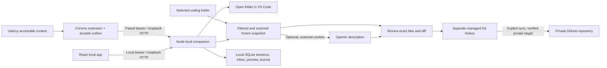

# Udemy first build

Implemented October 4, 2026. This is the current delivery scope and architecture. The full specification and earlier architecture/implementation plan retain the longer product roadmap; they do not describe every feature as already delivered.

## What works

- Windows launcher, local setup, responsive overview, courses, checkpoint timeline, and preferences.
- A separate Linear-inspired product page and complete seven-step setup guide at `/welcome`, linked from the workspace. The app stays at `/`; `/?view=setup` opens Settings directly.
- Chrome Manifest V3 extension: accessible Udemy course/section/lecture context, partial curriculum, one-time pairing, persistent outbox, reconnect and replay.
- Manual Udemy lesson entry when a layout does not expose usable context.
- Explicit course mirroring into stable section/lesson paths. Refresh retains previously discovered lessons and learner notes; edited manifests pause refresh.
- Start, pause, resume, discard, and finish a lesson session. Choose a new lesson workspace or an existing coding folder. Open the selected folder in VS Code.
- Learner notes and local text source snapshots, ignore rules, hard exclusions, secret scanning, editable commit messages, and exact file/diff review.
- Real local Git checkpoints using an isolated index, immutable reviewed tree, expected branch/HEAD checks, conditional ref advancement, durable save journal, and restart recovery.
- Optional OpenAI commit descriptions with deterministic fallback. Original notes remain verbatim.
- One parent Git archive with automatically created course/section/lesson folders; one optional private GitHub repository backs up saved history across all courses. GitHub setup verifies the signed-in account, gates repository actions, prepares Git credentials, verifies the private target, scans outgoing history, and syncs manually without force-pushing. Existing local checkpoints become pending when a remote is connected.

No GitHub repository is required for the complete local workflow. Coding workspaces remain separate from the managed history repository; existing source Git indexes, remotes, and history are untouched.

## Architecture

The code is one npm/TypeScript project. Shared schemas are in `src/shared.ts`; companion modules are in `src/server/`; the React workspace is in `src/ui/`; the separate product page is in `src/landing/`; Udemy extraction, extension worker, and popup are in `extension/`. Vite builds two HTML entries with shared React/icon assets. `scripts/build.mjs` creates `dist/server`, `dist/web`, and the unpacked `dist/extension`. The guide uses the existing companion and adds no hosted backend, router, or account system.

The companion binds only `127.0.0.1:47831`. Host/origin checks protect browser access. Local-page bootstrap requires a same-local-origin POST. A short-lived, one-use six-digit code grants an extension its own random bearer. Extension access is restricted to observations and connection status; it cannot choose folders, run Git, or call OpenAI. Chrome may omit Origin on extension GETs, so those still require the extension bearer.

Portable files live in the chosen managed Git repository. Operational state lives in `%LOCALAPPDATA%/GitForLearning/learning.sqlite`, outside OneDrive. The companion reads the root `.env`, supporting both `OPENAI_API_KEY` and `OPEN_AI_API`; neither frontend nor extension receives its value.

## Deliberate simplifications

| Earlier target | First build |
| --- | --- |
| pnpm workspace monorepo | One npm project with clear module boundaries |
| Native messaging host, registry registration, installer | Authenticated loopback HTTP and a Windows launcher |
| Separate VS Code extension | Local-app session controls and installed VS Code CLI |
| Packaged Node and native SQLite dependency | Installed Node 24+ and built-in `node:sqlite` |
| Continuous file watchers and automatic checkpoint triggers | Explicit Start / Finish; saved disk files collected during preview |
| Durable automatic push worker | Durable local checkpoints and explicit Sync now retry |
| AI note cleanup and broad manual learning sources | Original notes and Udemy-only context in this build |

Node's built-in SQLite is experimental in the tested Node version. Packaging, Edge verification, unsaved editor-buffer integration, learning-memory retrieval, other learning platforms, multi-device coordination, and richer course progress/resource capture remain future work. The Git repository is companion-managed: external edits/staging pause saves; direct existing-repository automation and normal Git hooks are outside this build.

## Validation and remaining limits

Automated validation uses temporary real Git repositories, HTTP boundary checks, sanitized Udemy DOM fixtures, the actual unpacked Chrome extension, and the full browser workflow. It covers exact reviewed-byte commits, source edits after review, excluded secrets, unrelated staging, branch changes, interrupted-save recovery, event deduplication, pairing, context capture, reconnect replay, and mobile overflow.

Verification includes backend tests, five browser workflows, a successful TypeScript/production build, and the Windows launcher. Additional checks cover multiple real course checkpoints in one archive, GitHub account verification and credential preparation, private repository creation arguments, shared-archive sync state, failed push preservation, retryable Git setup, AI outage fallback, unsafe model output, changed Git remotes, and alternate push destinations. GitHub command boundaries are mocked in these tests; live remote operations remain unverified as described below.

The supplied API key passed one minimal synthetic OpenAI request. Built assets were checked for accidental key inclusion. Application tests use no paid calls and no external repository writes.

Live authenticated Udemy layouts still need validation on the user's actual course. The adapter reports only accessible partial curriculum and includes manual fallback. GitHub CLI is installed on this machine. The checked account is not signed in, so live sign-in, repository creation, and pushing have not been performed. Complete sign-in and connect a repository in Settings before a real upload. A week of real learning remains the product usefulness check from the specification.

See the root [README](../README.md) for the shortest setup flow.
