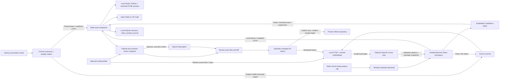

# GitLearn 0.3 Windows and Udemy preview

Updated October 10, 2026. This is the current delivery scope and architecture. The full specification and earlier architecture/implementation plan retain the longer product roadmap; they do not describe every feature as already delivered.

The [learning-to-contribution roadmap](learning-to-contribution-roadmap.md) and [supporting architecture](learning-architecture.md) define the path from tutorials to independent projects and guided open source work. Stage A's daily workspace is implemented in 0.3; independent tasks, practical project environments, personal reviews, and live contribution workflows remain planned.

## What works

- One evolving project per course, automatically created beside history or attached to an existing folder. Explicit course bindings have stable identities. Separate lesson folders remain available; upgrades preserve existing folders and checkpoints.
- **Continue building** restores the last lesson, coding folder, saved file position, session note, and latest available run. The recap uses stored activity and checkpoint messages. Missing files fall back to available files; an explicit Choose folder flow reattaches moved folders while preserving context and source Git history.
- **Give me a hint / Explain this error** attach server-recorded saved entry-file source/hash and actual bounded output to Code help. Entry-file changes are marked stale; incomplete runs and truncated evidence remain identified. Hint-first guidance is a prompt behavior, not proof of learner mastery or a guarantee about every generated answer. Fixes require a fresh local run.
- **Device readiness** checks bundled JavaScript, local Python, Git, writable folders, key/assistant status, and extension pairing. It displays no credentials. Coding, notes, and checkpoints remain usable without AI or GitHub.

- Windows desktop installer with an isolated Electron renderer, bundled JavaScript runtime, guided first-run setup, native folder picker, encrypted API-key storage, course workspace, checkpoint timeline, and preferences. Source-development launchers remain available.
- **Code & learn**: a Linear-inspired three-column workspace with course navigation, a real CodeMirror editor, and a course-specific assistant/source library. Light and dark themes, keyboard save/run, mobile panel switching, and lazy-loaded editor code.
- Real text-file reading, creating, and saving in the granted active lesson folder. Version checks preserve edits made externally; secret/system paths, traversal, oversized/binary files, and junctions are rejected. Unsaved changes protect navigation. Session notes autosave with a session identity check.
- Saved Python/JavaScript execution in the selected folder, ten-second/output limits, explicit Stop, and no companion credential environment inherited by child programs. Single-file inline HTML previews run in a restricted frame with no companion API/network access.
- Course RAG: local SQLite FTS5, optional cached OpenAI embeddings, hybrid course-scoped retrieval, local conversation history, structured citation validation, and inspectable source excerpts. **Ask the course** uses imported transcript/resource passages; **Code help** may also use working code, notes, and reviewed history. Source-free course questions report missing context.
- Explicit visible-transcript import from the Udemy extension, plus TXT/MD/SRT/VTT and paste imports in Sources. AI assistance is enabled independently of commit-message AI. Automatic indexing stays local; semantic batches run only on explicit refresh while the assistant is enabled.
- An independently deployable static marketing site with product proof, interactive assistant examples, a complete six-step guide, FAQ, downloads, and privacy. Vercel deploys only dist/site using committed configuration. The local guide is at `/welcome/`; the editor stays inside the Windows app. Chrome store publishing is pending.
- Chrome Manifest V3 extension: accessible Udemy course/section/lecture context, partial curriculum, one-time pairing, persistent outbox, reconnect and replay.
- Manual Udemy lesson entry when a layout does not expose usable context.
- Explicit course mirroring into stable section/lesson paths. Refresh retains previously discovered lessons and learner notes; edited manifests pause refresh.
- Start, pause, resume, discard, and finish a lesson session. Choose a new lesson workspace or an existing coding folder. Open the selected folder in VS Code.
- Learner notes and local text source snapshots, ignore rules, hard exclusions, secret scanning, editable commit messages, and exact file/diff review.
- Real local Git checkpoints using an isolated index, immutable reviewed tree, expected branch/HEAD checks, conditional ref advancement, durable save journal, and restart recovery.
- Optional OpenAI commit descriptions with deterministic fallback. Original notes remain verbatim.
- One parent Git archive with automatically created course/section/lesson folders; one optional private GitHub repository backs up saved history across all courses. GitHub setup verifies the signed-in account, gates repository actions, prepares Git credentials, verifies the private target, scans outgoing history, and syncs manually without force-pushing. Existing local checkpoints become pending when a remote is connected.

No GitHub repository is required for the complete local workflow. Coding workspaces remain separate from the managed history repository; existing source Git indexes, remotes, and history are untouched.

## Architecture

The code is one npm/TypeScript project. Shared schemas are in `src/shared.ts`; companion modules are in `src/server/`; the React workspace is in `src/ui/`; the static public site is in `src/site/`; the native bridge and utility-process entry are in `src/desktop/`; Udemy extraction, worker, and popup are in `extension/`. Vite builds the workspace into `dist/web`. The build also creates `dist/server`, `dist/desktop`, `dist/site`, and the unpacked `dist/extension`. Vercel publishes only the static site. The desktop runs the local companion in an Electron utility process and includes extension resources outside ASAR. There is no hosted learner backend or account system.

The companion binds only `127.0.0.1:47831`. Host/origin checks protect browser access. Local-page bootstrap requires a same-local-origin POST. A short-lived, one-use six-digit code grants an extension its own random bearer. Extension access is restricted to observations, explicit course-material import, minimal connection status, and focusing an already running desktop; it cannot choose folders, use the editor/runtime, run Git, or call OpenAI. Chrome may omit Origin on extension GETs, so those still require the extension bearer.

`workspace.ts` owns active-session file access, optimistic version checks, tracked child processes, and ephemeral preview capabilities. `library.ts` owns source chunks, FTS5, locally cached 384-dimensional `text-embedding-3-small` vectors, reciprocal ranking, bounded context, and chat. Six diverse retrieved passages feed Responses with `store: false` and structured citations. The answer stores cited passage snapshots so later source changes do not change the evidence shown. The default chat model is `gpt-4o-mini` (`OPENAI_CHAT_MODEL` overrides it). Source imports are secret-scanned and bounded to 120 documents/2,000 passages per course. Working files have priority over archived files in the bounded automatic code index. A semantic refresh processes at most 320 pending passages; keyword retrieval works immediately and remains available on an embedding outage.

Portable files live in the chosen managed Git repository. Operational state lives in `%LOCALAPPDATA%/GitForLearning/learning.sqlite`, outside OneDrive. Development can read the root `.env`, supporting both `OPENAI_API_KEY` and `OPEN_AI_API`. The packaged app never reads that file; native setup uses Windows account encryption and private IPC for the learner's key. Neither frontend nor extension receives its value.

## Deliberate simplifications

| Earlier target                                             | First build                                                                                          |
| ---------------------------------------------------------- | ---------------------------------------------------------------------------------------------------- |
| pnpm workspace monorepo                                    | One npm project with clear module boundaries                                                         |
| Native messaging host and registry registration            | Authenticated loopback HTTP with a Windows desktop installer; development launchers remain available |
| Separate VS Code extension                                 | Embedded CodeMirror editor with optional installed VS Code CLI                                       |
| Separate Node distribution and native SQLite dependency    | Bundled Electron JavaScript runtime and built-in SQLite; source development requires Node 24+        |
| Continuous file watchers and automatic checkpoint triggers | Explicit Start / Finish; saved disk files collected during preview                                   |
| Durable automatic push worker                              | Durable local checkpoints and explicit Sync now retry                                                |
| AI note cleanup and broad manual learning sources          | Original notes, course-material imports, and course RAG; Udemy focus                                 |

Windows x64 packaging is delivered as an unsigned preview. Edge verification, other learning platforms, multi-device coordination, video transcription, and richer course progress capture remain future work. The editor has no interactive shell, package manager, debugger, or language server. Python execution requires an installed interpreter; HTML preview supports inline assets only. The Git repository is companion-managed: external edits/staging pause saves; direct existing-repository automation and normal Git hooks are outside this build.

## Validation and remaining limits

Automated validation uses temporary real Git repositories, HTTP boundary checks, sanitized Udemy DOM fixtures, the actual unpacked Chrome extension, and the full browser workflow. It covers exact reviewed-byte commits, source edits after review, excluded secrets, unrelated staging, branch changes, interrupted-save recovery, event deduplication, pairing, context capture, reconnect replay, and mobile overflow.

Verification covers 67 backend cases, six affected 0.3 browser workflows, two static-site scenarios, the source and packaged Electron runtimes, and successful TypeScript/production builds. The unchanged extension pairing/import/replay flow retains its 0.2 validation; the 0.3 packaging checks are recorded in release-validation.md. Additional checks cover multiple course checkpoints in one archive, GitHub account verification and credential preparation, private repository creation arguments, shared-archive sync state, failed push preservation, retryable Git setup, AI outage fallback, unsafe model output, changed Git remotes, and alternate push destinations. Editor/RAG checks cover disk saves and JavaScript/Python execution, Stop, external-edit conflicts, restricted HTML preview, explicit extension transcript import, source deduplication/removal, course isolation, cached embeddings, missing evidence, cited passages, local history, and checkpoints. Routine tests mock remote APIs.

A separate live synthetic check passed semantic embeddings, a cited course answer, and an AI checkpoint using the supplied local key. No real learner course material or code was accessed. Site, extension, frontend, packaged ASAR, external extension resources, and staged source passed configured-key/environment-file scans. [Release validation](release-validation.md) contains the verification record.

Live authenticated Udemy layouts still need validation on the user's actual course. The adapter reports only accessible partial curriculum and includes manual fallback. Learner GitHub sign-in/private-repository creation still needs a live in-app check; publishing GitLearn's source and release assets does not verify that separate learner workflow. A week of real learning remains the product usefulness check from the specification. Chrome Store submission and Vercel account import remain separate release steps.

See the root [README](../README.md) for the shortest setup flow.
