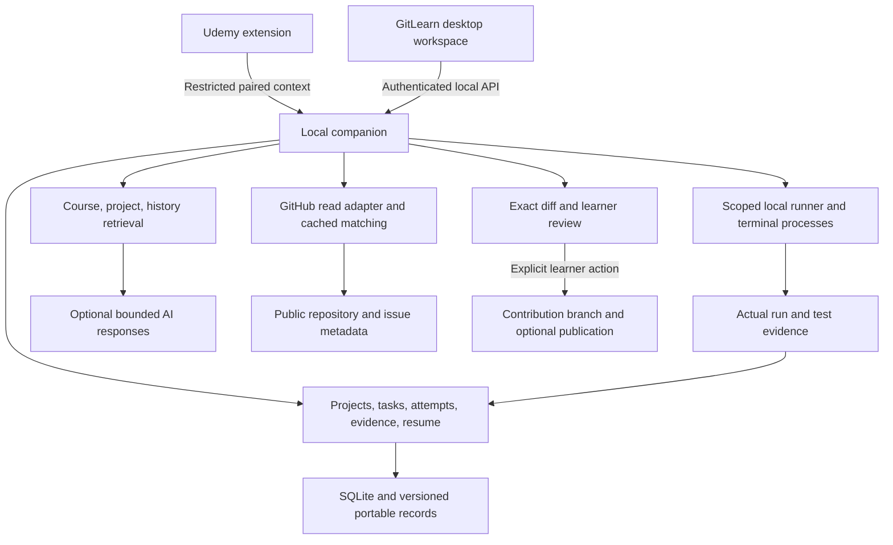

# Learning and contribution architecture

Stage A is implemented in the 0.3 preview using the existing SQLite key/value store: course project bindings, resume anchors, and up to twenty bounded runs per course. The editor restores saved file positions, exposes hint/explanation controls, and reattaches moved folders. Run evidence records the entry-file hash before execution and compares it afterward and before AI use; this does not fingerprint all imported modules or prove a proposed fix was tested. Future records below are introduced only when their stages are built.

Updated October 10, 2026. Architecture for [the learning-to-contribution roadmap](learning-to-contribution-roadmap.md). Stage A's delivered behavior is described above; the later-stage modules and records below remain proposed. Build on the [current desktop architecture](desktop-release.md): one TypeScript application, an isolated Electron window, a local companion, SQLite, existing Git checkpoints, course retrieval, and a restricted Chrome extension. The Vercel site remains marketing and downloads.

## Runtime ownership

Filesystem, processes, Git, HTTP calls, and credentials remain companion-owned. The renderer requests narrow operations using project/task IDs. It never receives GitHub or OpenAI secrets. The extension continues supplying accessible lesson context and explicit material imports; it receives no terminal, repository-write, or tutor privileges.

Keep core operations deterministic: path allocation, state transitions, run attribution, evidence references, review scheduling, candidate filtering, and publication decisions. AI proposes explanations, exercise variants, briefs, and cited summaries. Its output cannot execute a command or modify a repository.

## Data model added incrementally

| Record               | Minimum useful data                                                                                        | Integrity rule                                                                         |
| -------------------- | ---------------------------------------------------------------------------------------------------------- | -------------------------------------------------------------------------------------- |
| Learning goal        | Learner-entered outcome, interests, availability, preferred help style                                     | Optional, editable, no inferred employment promise                                     |
| Project              | ID, kind, granted root, runtime profile, course/lesson bindings, milestones                                | Never implicitly move an existing folder or reuse its Git authority                    |
| Resume anchor        | Project/task/lesson IDs, saved file and editor location, observed video position, last event               | Saved state only; reconcile missing/changed files before opening                       |
| Task                 | Objective/version, prerequisites, source/revision refs, starter provenance, rubric, verification profile   | Generated tasks need validation; absent course evidence is visible                     |
| Attempt              | Task/project ID, revision or frozen artifact, hint/solution usage, explanation, run refs, outcome          | Append-only attempts; stale run evidence cannot grade new bytes                        |
| Run evidence         | Command profile, project/cwd, input revision/hash, timestamps, exit, bounded output, test results          | Actual execution only; distinguish passed, failed, canceled, timed out, and unverified |
| Skill evidence       | Skill ID, attempt/project refs, assistance context, date, verified outcome                                 | Evidence supports a specific behavior, not a fabricated mastery score                  |
| Review item          | Objective, attempt refs, scheduling policy/version, due date, learner preference                           | Optional scheduling; idempotent completion and no silent notifications                 |
| Repository candidate | Canonical GitHub identity, issue ID, checked metadata, source URLs, fetched time, match reasons            | Cached snapshot, not a permanent claim that an issue is available                      |
| Contribution         | Repository/revision, selected issue, granted clone, branch, baseline, plan, run/diff refs, PR draft/status | Dedicated authority separate from the private history archive                          |

Use SQLite migrations and typed shared schemas when each record ships. Preserve the existing course/session/checkpoint IDs; add mappings rather than a disruptive rewrite. Store bounded structured run/test data and source references, not unlimited console logs or full copies of upstream repositories. Define migration fixtures and rollback/recovery behavior before distributing an upgrade. A user can export selected portable records without exporting live credentials or the SQLite database.

## Suggested module boundaries

Extend src/server/application.ts as the coordinator. Introduce modules only as their stage is implemented: projects/resume, attempts/practice, evidence/reviews, GitHub discovery, and contribution workflow. Reuse workspace.ts for granted file access and library.ts for retrieval. Extend github.ts with a separate read adapter before adding any contribution write operations. Add focused UI views to src/ui and shared request/result schemas to src/shared.ts.

Do not create a microservice, separate vector database, workflow framework, or empty provider layer. A small local catalog plus SQLite retrieval is enough for the first matching implementation. Long-running process management must be asynchronous and must not block the companion's requests or SQLite work.

## Retrieval and tutor contexts

Retain explicit retrieval scopes: Course, Active project, My learning, and Selected contribution. A request names its scope and user-selected code/error context. Course answers use permitted imported material; contribution answers use inspected repository material and issue/guideline snapshots. General programming advice is distinguished from claims about either source.

Citations include source type, course/repository identity, revision or content hash, path/line or transcript position when available, and fetched/saved time. Preserve the excerpt used in an answer. A later repository update does not rewrite old answer evidence. Revoked or deleted material is removed from current retrieval and affected historical records are handled according to the learner's deletion choice.

Cross-course memory is a separate opt-in retrieval scope. Repository discovery does not send a learner's private files to GitHub; match using local skill/interest tags against public metadata. Remote AI receives only bounded selected passages after assistance is enabled. Imported issue text, code, contributor instructions, and prior chat are untrusted data, not authority to run tools or change application policy.

## Local project execution

Separate bounded exercise runs from interactive terminals and managed development servers. Each process has a project grant, fixed cwd, tracked identity, lifecycle, sanitized credential environment, and bounded logs. Record the saved revision used for an exercise/test run. Mark results stale when relevant files change. Shutdown and Stop terminate the tracked process tree; reopening reports actual state rather than assuming a server is alive.

Project setup discovers supported manifest/runtime requirements and presents commands. Package installation, lifecycle scripts, shell commands, and remote-repository code execute only through the learner's explicit setup/run action. Use per-project environments and avoid modifying global Python or system configuration. A local preview allowlists the tracked project's origin/port and remains isolated from companion credentials and APIs. A terminal is a trusted local execution feature, not an arbitrary command endpoint granted to the browser extension or AI.

## Readiness and recommendation engine

First filter eligibility from checked repository/issue metadata, contributor requirements, runtime support, and issue availability. Then rank by demonstrated relevant tasks, learner interest, documented prerequisites, contribution scope, setup burden, and maintainer signals. Represent missing evidence explicitly. Keep rules/version and match reasons so ranking is explainable and reproducible. Learner-provided preferences and corrections can override recommendations.

Discover from a curated catalog, bounded GitHub issue searches, and pasted URLs. Normalize to GitHub repository/issue IDs; remote reads cannot access arbitrary local URLs or redirect to private services. Apply request timeouts, response limits, conditional caching, documented rate-limit handling, and cancellation. Revalidate issue status at selection and draft time. Changes produce a refreshed brief or alternative task, not an invalid success state.

The first contribution RAG index is scoped to the selected repository and bounded to relevant permitted source files, README, CONTRIBUTING, tests, and issue material. Indexing an arbitrary giant repository in full is not required. Explain index coverage and missing files; allow the learner to select additional relevant files. Respect project rules concerning AI assistance and surface unknown policies.

## Contribution state and Git boundaries

The persisted journey is discover, inspect, set up, reproduce, plan, implement, verify, review, draft, and respond. A learner can pause or revisit a step. External changes such as a closed issue or new upstream revision are separate events that require reconciliation. Draft prepared, published, awaiting review, changes requested, closed, and merged are distinct states.

Existing course checkpoints keep using the managed private history repository. A contribution uses a dedicated clone or explicitly granted contribution workspace and topic branch. The first version can guide publication through GitHub while retaining a local draft. Any later automated fork/push/PR action validates the selected account, fork, remote, branch, reviewed diff, and current issue; it requires its own learner-initiated publication action. Discovery and tutor responses never publish, comment, claim an issue, or contact a maintainer.

Do not overwrite unrelated staged work, rewrite upstream history, force-push, or report a PR as merged without an observed GitHub status. Contribution learning records preserve selected learner changes with upstream and assistance provenance. Public drafts exclude private course passages, credentials, unrelated work, and unverified testing claims.

## Verification tied to user outcomes

| Flow                 | Required evidence                                                                                                                          |
| -------------------- | ------------------------------------------------------------------------------------------------------------------------------------------ |
| Resume               | Restart, cross-course switch, missing path, unsaved work, actual lesson anchor                                                             |
| Project setup        | Supported Python/JavaScript app, isolated dependencies, input/Stop, server restart, scoped preview                                         |
| Tutor                | Correct error/revision, cited source, no-evidence response, helpful escalation, provider outage                                            |
| Practice             | Validated exercise, meaningful failing/passing variants, assistance attribution, unsupported execution                                     |
| Memory               | Revision-aware source, course isolation, explicit cross-course scope, deletion, correction, export                                         |
| Recommendations      | Actual issue fixtures, assigned/closed/stale changes, missing metadata, rate limit, no match, explainable ranking                          |
| Contribution         | Baseline versus regression, dedicated branch, exact diff, existing-index preservation, local PR draft, feedback, no implicit public writes |
| Upgrade/distribution | Migration/recovery, packaged resource/runtime access, key exclusion, real supported Udemy layout                                           |

Use synthetic repositories and sanitized course fixtures for automated tests. Add a small voluntary real-course/project beta and a learner-selected live contribution check when those stages ship. Actual independent task performance and maintainable reviewable changes are product evaluation outcomes; automated app tests alone do not establish industry readiness.

Coding-agent providers and managed AI accounts remain separate future integrations. They must not introduce architectural dependencies or fake sign-in surfaces into the learning stages.
