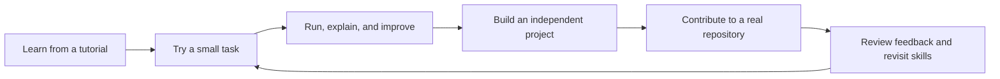

# GitLearn: from tutorials to independent work

Updated October 10, 2026. This is the implementation-ready roadmap requested after the Windows 0.2 preview. Stage A is delivered in the 0.3 preview; the later stages remain planned. [Current build](current-build.md) remains the delivery record. This roadmap takes priority over the older platform-expansion order in [implementation-plan.md](implementation-plan.md). [Learning architecture](learning-architecture.md) defines the supporting data and module boundaries.

## Product outcome

GitLearn should help a learner use a tutorial, understand an implementation, practice without the example, build a complete project, and contribute responsibly to a real repository. The product should answer three practical questions: where do I continue, what should I try myself, and what evidence shows I can do it?

The first audience remains people learning programming through Udemy while working locally. The same learning engine can later serve other video platforms, documentation, coding exercises, and independent study. Platform support follows a useful learning workflow.

## 1. Continue learning with almost no setup

The Today view has one primary action: Continue. It restores the last course or project, selected lesson, saved file and editor location, unfinished task, and notes. A short factual recap shows the last saved activity, unresolved run result, and suggested next action. Suggestions cite their supporting attempt or checkpoint and remain editable.

Offer sessions such as a quick review, a short practice task, or continuing a project, based on the learner's available time. These are choices, not interruption dialogs. A goal and weekly availability are optional; the learner can adjust the plan or skip a suggestion.

Store a video position only when the supported adapter actually observes it. Otherwise link to the lesson without inventing a timestamp. Missing folders, removed files, disconnected extensions, and changed lessons have clear recovery paths. Never overwrite unsaved work during resume.

Acceptance: restarting restores the correct project and task; switching courses does not mix state; a missing file offers alternatives; returning learners reach their saved work through one primary action.

## 2. Contextual tutoring and debugging

Add direct actions beside code and run output: Explain this error, Give me a hint, Explain this selection, and Test my understanding. The learner can see which file, run, lesson, and sources will be included. Context is bounded to the active task and selected code; unrelated files are not silently sent.

Use a progressive help flow: identify the problem, offer a diagnostic question or hint, show a relevant example, and provide a complete explanation when requested. The learner controls the amount of help. Tutor mode must not trap someone in repeated questions when they need an answer.

Separate evidence from suggestions. A runtime result comes from the actual runner. An explanation of the instructor's material requires an imported passage. A proposed fix is not described as tested until it has been run. Without course content, general programming help remains available and is labeled accordingly.

Remember the current debugging attempt so follow-up messages can reference the actual error and latest saved revision. Mark old run output when the file changes. Save useful explanations as learner-selected notes with their provenance.

Acceptance: a representative JavaScript and Python error produces a relevant explanation using the correct run; stale output is distinguished; missing course material is explicit; hints and full answers both work; API failure preserves the task and local code.

## 3. Practice that transfers beyond the example

### Practical work during the course

Do not wait for course completion. A small, optional suggestion can appear after a relevant saved lesson, at a section transition, or after a demonstrated practice skill. Each suggestion explains the observed trigger, required prerequisites, expected effort, and useful outcome. A first successful run can introduce a small transfer task; broader projects follow demonstrated attempts. Open source exploration can begin with documentation or reproduction before larger code changes are appropriate. Partial curriculum and missing transcripts never become invented readiness signals.

The learner can start, defer, dismiss, or choose another task. Suggestions do not pause a video or block course access. Cooldowns and one active task prevent repeated interruptions. During practical work the assistant acts as a teacher: inspect the goal and actual attempt, ask a diagnostic question, offer a progressive hint, discuss tradeoffs, and help the learner interpret real tests. It cannot edit, complete the task, or publish work. Recheck practical opportunities as evidence develops rather than waiting for the final lesson.

After a lesson, suggest one small task: predict output, explain a decision, repair a bug, change a requirement, or implement a related feature. The learner may try, defer, skip, or choose another task. The course remains accessible throughout.

Every exercise has a specific objective, prerequisites, source references, starter provenance, expected behavior, a rubric, and a verification method. Start with curated JavaScript/Python templates and reviewed test cases. Generated variations use validated schemas and bounded source material. A model-generated test alone is insufficient evidence that an exercise is sound; reject contradictory or unverifiable tasks and offer a curated alternative.

Record attempts separately, including code revision, actual test results, hints used, solution revealed, and the learner's explanation. Give concrete feedback about the failed behavior and a useful next step. Preserve earlier attempts for comparison.

Offer a later variation without the original example. An unassisted attempt means no GitLearn hints or solution were used in that attempt; the app cannot prove whether outside help was used. Passed tests demonstrate the tested behavior, not universal mastery. If execution is unsupported, show Needs verification instead of success.

Acceptance: a changed requirement requires applying the concept; failing code does not pass; revealed solutions are recorded; attempts survive restart; tests cover behavior rather than copying implementation; the learner can explain the change and revisit it later.

The tutoring design draws on [Khan Academy's published approach](https://blog.khanacademy.org/khan-academys-7-step-approach-to-prompt-engineering-for-khanmigo/), including feedback and self-explanation. [Karpicke and Blunt's retrieval-practice study](https://pubmed.ncbi.nlm.nih.gov/21252317/) supports practicing recall in conceptual learning. Its experiments used science texts; the coding-task design here is a hypothesis to evaluate with GitLearn learners, not a demonstrated effect of this product.

## 4. Course projects and independent projects

A course can bind lessons to one evolving project while retaining per-lesson history. Support existing learner folders and the current separate-lesson mode. Changing this association does not move files or alter an existing repository without a specific reviewed action.

Project setup checks Git, supported runtimes, and project requirements. Add a real terminal with input, scoped process tracking, per-project Python environments, dependency-install steps, and a local application preview. Long-running development servers need explicit Start/Stop and lifecycle handling separate from the current ten-second exercise runner. Show the project directory and proposed setup command before executing repository scripts. The app must describe local execution accurately; it is not a security sandbox for arbitrary repositories.

Begin with supported Python and JavaScript projects, then a bounded React/Vite project flow. Do not claim compatibility with every toolchain. Keep the editor and tutor focused; VS Code remains an optional handoff.

Independent projects begin with a short brief: user need, constraints, acceptance criteria, milestones, and a first implementation task. Suggestions use the learner's goals and demonstrated attempts. A small working feature comes before additional infrastructure.

Project review covers applicable professional practices: readable structure, tests, error handling, debugging, reproducible setup, documentation, and accessibility for interfaces. Reviews distinguish observed results from AI suggestions. The learner should be able to explain a design choice, change a requirement, and diagnose a regression. Security or production readiness is not certified by an AI checklist.

Acceptance: a supported app starts after guided setup, dependencies remain scoped to its project, stopping terminates tracked children, restarts recover process state accurately, and an independent project meets its stated requirements with reproducible evidence.

## 5. Learning memory, short reviews, and useful progress

Use a small skill vocabulary with versioned objectives. Associate skills with lesson sources, tasks, attempts, and project evidence. Preserve uncertainty and allow learners to correct associations; avoid an elaborate concept graph in the first release.

Keep watched/completed lesson status separate from practice evidence. Useful states include encountered, practiced with help, completed in an unassisted GitLearn attempt, and due for review. Each state links to the task and date that supports it. Do not infer proficiency from chat volume, watch time, or an arbitrary confidence percentage.

Remember explicitly recorded difficulties and actual failed attempts. A memory answer can say, for example, that a prior project used the same async pattern, with a link to the exact saved file or checkpoint. Cross-course retrieval is a separate Search my learning action; ordinary course chat remains scoped to its course.

Schedule short review tasks using prior attempts, elapsed time, and learner preferences. Successful attempts can increase the interval; failed attempts produce a smaller follow-up. Keep the scheduling policy configurable and record why a task was suggested. Reviews can be snoozed, disabled, or limited by available time. Notifications require an opt-in.

Export selected evidence as a project development story: original requirement, own changes, attempts, tests, decisions, and relevant checkpoint links. Label starter code and AI assistance accurately. Never generate credentials, job-readiness certificates, or fabricated accomplishment claims.

Acceptance: a progress entry is traceable to evidence; deleted sources and memory associations stop appearing; course isolation holds; review tasks are feasible and optional; export excludes private transcripts, credentials, and unrelated code by default.

## 6. Live work: guided open source contributions

Live work is a dedicated section for finding a suitable real repository, understanding a contribution, completing it locally, and preparing a reviewable pull request. It offers practice in collaboration and unfamiliar codebases. It does not promise paid work, maintainer acceptance, or employment readiness.

### Readiness and matching

Use the learner's selected languages, interests, completed project tasks, recent unassisted attempts, and available time. Readiness is specific to a task: a documentation improvement, a reproduction, a regression test, and a feature change require different evidence. Learners can browse at any level. Missing prerequisites produce a suggested preparation task rather than a locked section.

Start discovery with a small curated repository catalog and fresh GitHub metadata. Retrieve a bounded set of candidate issues instead of scraping GitHub broadly. Use good first issue and help wanted as discovery signals, then inspect the issue and contributor guidelines. Those labels are not a difficulty guarantee.

Filter or flag archived repositories, unknown licensing, closed or assigned issues, existing implementation PRs, unclear scope, incompatible environments, missing contributor instructions, and project policies concerning AI assistance. Consider recent maintainer responses and contribution activity; stars alone do not establish quality or suitability. Missing information is shown as unverified.

Return a short ranked list with repository and issue links, observed stack, matched skills, prerequisites, setup burden, contribution type, maintainer signals, and last-checked time. Explain Why this fits and What to prepare. Rank using explicit rules first; an AI explanation may summarize checked evidence but cannot invent an issue, score, or policy.

Allow refresh, save, dismiss, and pasting a repository/issue URL. Recheck the selected issue before starting and before preparing a PR. Respect GitHub rate limits, cache responses, honor retry/reset instructions, and retain an honestly dated offline list. If no good match exists, offer a preparation task or manual repository selection.

### Contribution workflow

1. Inspect a sourced brief: issue requirements, relevant contributor rules, likely code areas, known uncertainties, and the first action. File relevance is a hypothesis until inspected.
2. Choose the repository and a dedicated local contribution folder. Forking or configuring a remote is a learner-initiated action. An existing personal folder is never silently repurposed.
3. Read setup requirements, inspect proposed commands, install the required project environment, and run the baseline checks. Repository scripts are not automatically executed during discovery or clone.
4. Reproduce the issue or confirm the requested documentation/test improvement. Record actual behavior and baseline failures; distinguish pre-existing failures from new regressions.
5. Work through a small plan with a repository-scoped tutor. Retrieve relevant code, README, CONTRIBUTING, issue discussion, and test evidence with revision-aware citations. The assistant explains unfamiliar code and design constraints without claiming to have performed actions it has not taken.
6. Make learner-owned changes on a contribution branch, run relevant tests/lint, and review the exact diff. The private learning archive stores selected patches, notes, and evidence with upstream provenance; it does not copy the entire upstream codebase as learner-authored work.
7. Prepare a local PR draft containing the problem, change, tests actually run, limitations, and project-required disclosures. Public posting and pushing require a separate explicit learner action. The first version may open GitHub with the prepared draft; later write automation needs its own verified authorization flow.
8. Help interpret maintainer feedback, associate it with the relevant code, and plan a revision. A pending, rejected, closed, or merged PR retains its accurate status. Learning evidence does not depend on a merge.

Acceptance: recommendations link to real currently checked issues; a selected issue that closes is handled; requirements and policies have sources; a synthetic fixture covers the full contribution journey; upstream/existing source Git state is preserved; no comment, fork, push, or PR is created by discovery or chat; all public drafts are reviewable before submission.

GitHub's guidance emphasizes project rules, approachable issues, branches, review, and maintainer feedback. Its API documentation supplies the request/caching constraints. Sources: [contribution workflow](https://docs.github.com/en/get-started/exploring-projects-on-github/contributing-to-open-source), [good first issue labels](https://docs.github.com/en/communities/setting-up-your-project-for-healthy-contributions/encouraging-helpful-contributions-to-your-project-with-labels), [API rate limits](https://docs.github.com/en/rest/using-the-rest-api/rate-limits-for-the-rest-api). Matching and readiness rules above are GitLearn product decisions, not GitHub guarantees.

## 7. Product experience and public adoption

Retain the blue GitLearn identity and quiet desktop workspace. Navigation becomes Today, Courses, Projects, Practice, and Live work as those features ship. The center holds the current task or code; the right panel offers Tutor and Sources. Reviews, plans, and results stay beside the work they describe. Empty states explain one useful action; unfinished roadmap features do not appear as inert navigation items.

Use visible progress and small contextual actions. Avoid mandatory quizzes, guilt-based streaks, constant chat interruptions, and large dashboards of unsupported scores. Preserve keyboard navigation, readable contrast, light/dark themes, and the ability to collapse assistance.

Public release work includes authenticated real-Udemy validation, Chrome Store submission, installer signing when available, versioned download links, recoverable upgrades, and clear environment diagnostics. Managed AI access is optional later: accounts, secure credential handling, quotas, usage visibility, billing, export, and deletion must precede any hosted plan. Do not put a developer key in an installer or on Vercel. Local editing and history remain useful without hosted AI.

## 8. Delivery order and exit criteria

The 0.3 implementation completes Stage A's local foundation: course project bindings, factual Continue, saved-file/cursor anchors, bounded actual run evidence with stale detection, hint/explanation controls, moved-folder recovery, and device diagnostics. The code stays in the existing local app. Stages B-F remain planned; coding-agent integration remains deferred. See [current build](current-build.md) for delivered behavior and [release verification](release-validation.md) for test evidence.

| Stage                         | Deliverable                                                                                                                    | Exit criterion                                                                                                                                            |
| ----------------------------- | ------------------------------------------------------------------------------------------------------------------------------ | --------------------------------------------------------------------------------------------------------------------------------------------------------- |
| A: dependable daily workspace | Persistent course projects, factual Continue recap, contextual error help, runtime/setup diagnostics                           | A returning learner resumes and runs an existing supported Python/JavaScript practice workspace without reorganizing files or re-explaining their context |
| B: practical projects         | Scoped environments, interactive terminal, managed development servers, project preview, briefs and milestones                 | A supported Python/JavaScript project is built and tested locally from a reproducible brief                                                               |
| C: practice and feedback      | Curated tasks, grounded variations, attempts, hints, behavioral checks, changed-requirement tasks                              | Learners complete comparable tasks with decreasing assistance; failure and unverifiable cases remain accurate                                             |
| D: memory and review          | Evidence-backed skills, cited past attempts, opt-in cross-course search, short scheduled reviews, export                       | A learner can recover an explanation and demonstrate a concept again with traceable evidence                                                              |
| E: live work discovery        | Curated catalog, live GitHub issue checks, explainable matching, prerequisite tasks, saved shortlist                           | The learner selects a real suitable issue with an accurate brief and setup requirements                                                                   |
| F: contribution workspace     | Repository-scoped RAG, baseline/reproduction, contribution branch workflow, diff/test review, local PR draft, feedback history | One supported contribution flow reaches a correct reviewable draft without unrequested public writes                                                      |
| G: broader access             | Store distribution, tested upgrades, additional adapters and OS support, optional managed AI                                   | Each expansion passes real-platform, privacy, recovery, and cost checks                                                                                   |

Complete a narrow end-to-end stage before adding more surfaces. Public release preparation can proceed alongside the daily-workspace stages. Platform expansion remains planned, including coding problems, interactive courses, YouTube, documents, and notebooks; choose the next adapter from beta evidence. Do not assign dates until representative project/runtime and contribution feasibility checks pass.

Start evaluation with a small voluntary beta on actual Udemy courses. Measure time to first successful run, successful session resume, saved work recovery, independent task attempts, comparable task performance, useful return sessions, and contribution drafts that satisfy the selected repository's requirements. Record AI cost and source availability, not just chat activity. Use short interviews to identify where learners still need to leave GitLearn.

### First implementation slice

| Work item                         | Existing entry points                                                 | Reviewable result                                                                                                                                                  |
| --------------------------------- | --------------------------------------------------------------------- | ------------------------------------------------------------------------------------------------------------------------------------------------------------------ |
| A1: project binding and migration | src/shared.ts, src/server/store.ts, src/server/application.ts         | Associate an existing course with a stable project ID/root; retain old lesson paths and checkpoints; recover a migration safely                                    |
| A2: persistent course workspace   | src/server/workspace.ts, src/ui/main.tsx, src/ui/studio.tsx           | Choose separate lesson folders or one evolving course project; preserve existing files and source Git state                                                        |
| A3: Continue anchor               | Store/application plus the workspace UI                               | Restore saved file/location, course/lesson, unfinished activity, and factual recap after restarting; handle missing files                                          |
| A4: trusted error context         | src/server/workspace.ts, src/server/library.ts, src/ui/studio.tsx     | Persist bounded run evidence keyed to saved bytes; Explain this error sends the selected actual run and code with visible context; mark stale runs                 |
| A5: setup diagnostics             | src/desktop/bridge.ts, src/desktop/main.ts, onboarding/settings       | Explain missing prerequisites and active folder/runtime/key status without exposing credentials; retain a usable local fallback                                    |
| A6: one complete user journey     | Workspace/application tests, browser workflow, packaged desktop check | Resume a course project across two lessons, run/fix code, get grounded help, save a reviewed checkpoint, and recover after restart; a second course stays isolated |

Only the records and interfaces used by this slice are introduced. Exercise generation, recommendation ranking, contribution publication, and provider integration remain out of this first slice. Deliver and validate A before creating the UI for later stages.

## 9. Coding agents: deferred exploration

Keep coding-agent integration as an explicitly deferred idea. Do not implement provider login, an agent marketplace, autonomous editing, or automatic public actions in these stages. A later investigation must establish each provider's supported authentication/integration, subscription versus API entitlement, permissions, cost visibility, action review, and how assistance is recorded in learning evidence. Existing GitLearn tutoring does not depend on this future integration.
